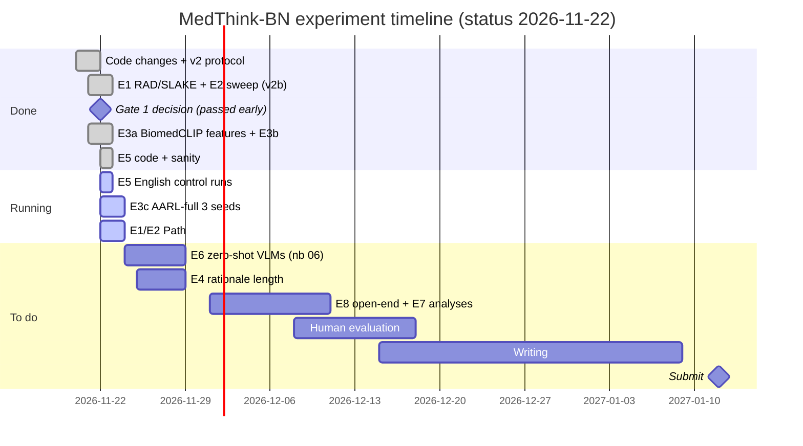

# 12 — Experiment Progress Chart (snapshot 2026-11-22 18:25)

The plan is in doc 05, the timeline in doc 07, and the latest results in doc 13. Update this chart whenever a batch finishes.

Legend: ✅ done · 🟡 partly done or running · ⏳ queued · ⬜ not started · 🔧 code or notebook still needed first

## 1. At a glance

```
Code & protocol (doc 03/08)  ██████████  100%  ✅ v2b protocol, segment loss, ablation, choice scoring, BMC + EN switches
E0  image ablation           ████████░░   80%  🟡 in every run; BMC flips SLAKE to real image use (zero-image 50 vs 71)
E1  re-baseline (closed)     ████████░░   80%  🟡 RAD+SLAKE done (3 seeds); Path 2/6 (w/o-R 83.4, Expl 73.0)
E2  segment-balanced loss    ████████░░   80%  ✅ gate passed (doc 13); α=0.5 best; Path α=0.5 running
E3  BiomedCLIP + warm-up     ████████░░   80%  🟡 E3b done (SLAKE 88.5 vs 77.9); E3c 3-seed confirm 0/12 (5 running)
E4  rationale length         ░░░░░░░░░░    0%  🔧 needs a truncation flag
E5  English control          ██████░░░░   60%  🟡 3/6: RAD Δ(Expl−w/o-R) EN −1.9 vs BN −4.4; SLAKE Expl pending
E6  zero-shot VLMs           ░░░░░░░░░░    0%  🔧 notebook missing; MedGemma access unknown
E7  inference analyses       ███░░░░░░░   30%  🟡 choice scoring + McNemar done; consistency/breakdowns missing
E8  open-end final           ░░░░░░░░░░    0%  🔧 waits for AARL-full; launcher is closed-end only
Human evaluation (doc 06)    ░░░░░░░░░░    0%  ⬜ sheets not built
Tier 2                       ░░░░░░░░░░    0%  ⬜ only if Tier 1 is on time
```

**Decision gate Dec 7: PASSED on 2026-11-22** (doc 13). α=0.5, 3 seeds: RAD 74.9 vs w/o-R 69.0 (+5.9, p=6e-5); SLAKE 78.4 vs 78.8 (−0.3, p=0.82).

## 2. Experiment tracker

| ID | Experiment | Runs done / total | Status | Needs (notebook / code) | Est. GPU-h | Plan week | Feeds |
|---|---|---|---|---|---|---|---|
| — | Code changes: val split, early stopping, seeds, segment loss, choice scoring, ablation, gate switches | — | ✅ | — | — | W0 | all |
| — | Protocol fix v2 → v2b (patience 15/15/5, min_epochs 50%) | — | ✅ | — | — | W1 | all |
| E0 | Image ablation (real / zero / shuffled) | all v2b runs | 🟡 | ✅ built in. DETR: images barely used (Path: zero = real). BMC on SLAKE: zero-image −38 pts. Still to do: DETR vs AARL figure | 0 | W1 | Fig. 3 |
| E1 | Closed-end baselines, 3 seeds: RAD, SLAKE | 14 / 14 | ✅ | ✅ nb 02 + `launch_runs.py` plan `e1` | ~20 | W1 | Tab. 2, 3 |
| E1 | Closed-end baselines, 3 seeds: **Path** (w/o-R, Expl, α=0.5) | 2 / 9 | 🟡 | w/o-R s44 83.4 (0.7 h); Expl s42 73.0 (2.4 h, best = cap 12/12); 2 running, 5 queued | ~18 | W1 | Tab. 3 |
| E2 | α sweep {0.5, 0.8, 0.95}, seed 42 | 6 / 6 | ✅ | ✅ plan `week2` | ~9 | W2 | Fig. 2, Tab. 4 |
| E2b | α=0.5 seeds 43/44 (RAD, SLAKE) + α=0.3 | 6 / 6 | ✅ | ✅ plan `e2b` | ~10 | W2 | Tab. 3, 4 |
| E2 | Best α on Path, 1 seed | 0 / 1 | ⬜ | Plan entry | ~2.5 | W2 | Tab. 3 |
| E2 | Rationale dropout 50% (optional) | 0 / 2 | 🔧 | `rationale_dropout` in the library | ~3 | W2 | Tab. 4 |
| E3a | BiomedCLIP feature extraction | 1 / 1 | ✅ | ✅ nb 01b ran 21:48 (5131 imgs, 1.55 GB); dataset `towhaelahi/medthink-bn-biomedclip` created and shared (2026-11-22); sanity passed. Done: upload output as `towhaelahi/medthink-bn-biomedclip`, share with 4 co-author accounts | ~1 | W0 → late | E3b/c |
| E3b | 2×2 {DETR, BiomedCLIP} × {no warm-up, warm-up + gate −1}, α=0.5, s42 | 6 / 6 new (+2 existing DETR/plain) | ✅ RAD 2×2 complete: DETR 75.7 · DETR+gb−1+vw1 74.6 (λ 0.119) · BMC 75.0 · BMC+gb−1+vw1 74.3 (λ 0.030), all within seed noise. **SLAKE BMC 88.5 vs DETR 77.9** (+10.6; zero-image 50.2, shuffled 65.9). SLAKE BMC + gb−1 + vw1: 85.6 (warm-up does not help); SLAKE DETR + gb−1 + vw1: 81.0. Warm-up helps DETR on SLAKE a little (+3.1, 1 seed) but hurts BMC | ✅ launcher: `run(..., features="biomedclip")` → slug `-bmc`, attaches the feature dataset. Waits for E3a | ~6 | W3 | Tab. 4 |
| E3c | AARL-full = α=0.5 + BiomedCLIP (no warm-up): seeds 43/44; w/o-R + BMC × 3; vanilla Expl + BMC s42; RAD + SLAKE | 0 / 12 | 🟡 5 running (α=0.5+BMC s43/s44 both datasets, RAD w/o-R+BMC s43), 7 queued | ✅ plan `e3c` | ~18 | W3 | Tab. 3, 4, Fig. 3 |
| E4 | Rationale length: full / 2 sentences / 1 sentence | 0 / 4 | 🔧 | `rationale_max_sents` flag (Bengali sentence split on । ? !) | ~4 | W2 | Fig. 4 |
| E5 | English same-pipeline control (UnifiedQA-T5-base, EN JSONs) | 3 / 6 | 🟡 | ✅ `set_language` + `overlay_language` + `LANG/MODEL/LR` + launcher `lang="en"` (doc 08). Plan `e5`: {w/o-R, Expl, α=0.5} × {RAD, SLAKE}, s42. Done: RAD w/o-R 74.3, RAD Expl 72.4, SLAKE w/o-R 80.5. Running: RAD α=0.5, SLAKE Expl, SLAKE α=0.5 | ~6 | W2 | **Tab. 2 (core C2)** |
| E6 | Zero-shot VLMs: Qwen2.5-VL-3B, MedGemma-4B; BN + EN prompts | 0 / 12 evals | 🔧 | **nb 06 (new)**; HF access to MedGemma | ~4 | W1 → late | Tab. 3 |
| E7 | Choice-scoring accuracy | all v2b runs | ✅ | — | 0 | W4 | Tab. 3 |
| E7 | Rationale–answer consistency (feed rationale to the stage-2 model) | 0 | 🔧 | nb 07 (new) or a section in nb 05; stage-2 checkpoint | ~1 | W4 | Tab. 5 / text |
| E7 | Per question type / organ / modality breakdown | 0 | 🟡 | `content_type` is carried in preds; table and plot in nb 05 | 0 | W4 | Fig. 5 |
| E7 | McNemar tests on paired predictions | v2b done | ✅ | `experiments/analyze_v2b.py` (doc 13) | 0 | W2 | Tab. 3 |
| E8 | Open-end: 3 datasets × {w/o-R, AARL-full} | 0 / 6 | 🔧 | nb 03 has v2; the launcher needs an open-end template; BanglaBERT-BERTScore | ~10 | W4 | Tab. 5 |
| T2-1 | mT5-base EN vs BN | 0 | ⬜ | config only | ~17 | W4+ | Tab. 2 |
| T2-2 | BN question → EN rationale | 0 | ⬜ | data plumbing | ~6 | W4+ | Discussion |
| T2-3 | QLoRA Qwen2-VL-2B | 0 | ⬜ | new nb | ~8 | W4+ | Tab. 3 |
| T2-4 | Competitor Bangla Med-VQA set | 0 | ⬜ | depends on release | ~1 | W4+ | Generalisation |

**GPU budget.**
- Tier 1 still to run: about 60 GPU-h, plus about 15 for Path.
- Capacity: 5 accounts × 30 h = **150 GPU-h/week**. Compute is no longer the bottleneck; building notebooks and code is.

## 3. Run grid: closed-end, protocol v2b (test ChoiceAccuracy)

| Dataset | w/o-R s42 / s43 / s44 | Explanation s42 / s43 / s44 | Reasoning s42 | α=0.5 s42 / s43 / s44 | α=0.8 s42 | α=0.95 s42 | α=0.3 s42 |
|---|---|---|---|---|---|---|---|
| RAD | ✅ 70.2 / ✅ 69.1 / ✅ 67.6 | ✅ 65.8 / ✅ 63.6 / ✅ 61.4 | ✅ 58.1* | ✅ **75.7** / ✅ **74.3** / ✅ **74.6** | ✅ 71.7 | ✅ 69.5 | ✅ 71.0 |
| SLAKE | ✅ 79.8 / ✅ 77.2 / ✅ 79.3 | ✅ 64.2 / ✅ 66.8 / ✅ 63.5 | ✅ 61.1* | ✅ **77.9** / ✅ **80.5** / ✅ **76.9** | ✅ 73.8 | ✅ 77.9 | ✅ 79.1 |
| Path | ⏳ / 🟡 / ✅ 83.4 | ✅ 73.0 / ⏳ / ⏳ | — | 🟡 / ⏳ / ⏳ | — | — | — |

\* Reasoning reports generative `Accuracy` (no choice scoring).

### 3b. Visual encoder (E3), Explanation + α=0.5 unless noted

| Dataset | DETR | DETR + gb−1 + vw1 | BMC | BMC + gb−1 + vw1 | BMC α=0.5 s43 / s44 | w/o-R + BMC s42 / s43 / s44 | Expl (no α) + BMC s42 |
|---|---|---|---|---|---|---|---|
| RAD | 75.7 | 74.6 | 75.0 | 74.3 | 🟡 / 🟡 | ⏳ / 🟡 / ⏳ | ⏳ |
| SLAKE | 77.9 | 81.0 | **88.5** | 85.6 | 🟡 / 🟡 | ⏳ / ⏳ / ⏳ | ⏳ |

Image ablation, SLAKE: DETR real / zero / shuffled = 77.9 / 70.7 / 71.6; BMC = 88.5 / **50.2** / 65.9. McNemar BMC vs DETR p = 1e-8 (1 seed).

### 3c. English control (E5), UnifiedQA-T5-base, seed 42

| Dataset | EN w/o-R | EN Expl | EN α=0.5 | EN Δ (Expl − w/o-R) | BN Δ, same seed (3-seed mean) |
|---|---|---|---|---|---|
| RAD | 74.3 | 72.4 | 🟡 | −1.9 (p = 0.61) | −4.4 (−5.4, p = 0.006) |
| SLAKE | 80.5 | 🟡 | 🟡 | — | −15.6 (−14.0, p = 4e-17) |

- EN rationale quality: ROUGE-L 31.2 vs BN 20.3 (RAD Expl).
- The English pipeline does *not* reproduce the paper's "rationales help in English" on RAD (Δ −1.9, within noise).
- C2 may need to be phrased as "rationales hurt far more in Bangla". SLAKE decides.

Superseded runs:
- old v2 (patience 5) in `experiments/results/v2/mtbn-v2-*`
- paper-protocol grid in `all_results.csv`, kept for the appendix

## 4. Notebooks & code inventory

### Existing
| Notebook | Purpose | v2b-ready | Status |
|---|---|---|---|
| 00_data_prep | Manifests / splits | ✅ | ✅ done; dataset `medthink-bn-manifests` |
| 01_extract_detr_features | DETR 100 × 256 features | ✅ | ✅ done; dataset `medthink-bn-features` |
| 02_train_closed_end | Closed-end training + eval (ablation, choice scoring, rationale metrics) | ✅ | ✅ in use via `experiments/launch_runs.py` |
| 03_train_open_end | Open-end training | 🟡 has v2; no launcher template yet | ⬜ unused since v2 |
| 04_two_stage_reasoning | Two-Stage (appendix only) | — | ✅ old grid only |
| 05_results_report | Aggregation, tables | 🟡 section 1b must point at `results/v2/mtbn-v2b-*` and add McNemar | 🔧 |

### To build
| New item | For | Priority (by deadline) |
|---|---|---|
| ~~01b_extract_biomedclip_features~~ ✅ built 2026-11-21; still needs the Kaggle run + dataset upload | E3 | **High.** Blocks E3b/E3c in W3 |
| ~~English-control support~~ ✅ built 2026-11-22 (doc 08) | E5 | done; runs pending |
| **06_zero_shot_vlm** (Qwen2.5-VL-3B, MedGemma-4B; BN/EN prompts) | E6 | Medium–High |
| `rationale_max_sents` flag in the library and launcher | E4 | Medium |
| ~~Path entries~~ ✅ plans `pathsanity`, `pathe1` | E1/E2 | done |
| Launcher open-end template (nb 03) + BanglaBERT-BERTScore metric | E8 | Medium (W4) |
| 07_inference_analyses (consistency, breakdowns) or nb 05 sections | E7 | Medium (W4) |
| Human-eval sheet generator (doc 06) | Human eval | Medium (needed by W3) |
| `rationale_dropout` | E2 optional | Low |

### Infrastructure (done)
- `experiments/launch_runs.py`: plans, scheduler, 5 accounts, AARL passthrough, suspend-safe polling
- `experiments/fetch_results.py`: downloads results files only
- **KaggleFleet** (`../kaggle-fleet`, state `~/.kaggle_fleet`): 5 accounts, isolated OAuth, web panel with link sign-in. It replaced the in-project `kaggle_hub` on 2026-11-21.

## 5. Non-compute tasks

| Task | Owner | Status | Due |
|---|---|---|---|
| Read the two competing Bangla Med-VQA papers (doc 02) | team | ⬜ | W0 (overdue) |
| Request MedGemma access on HF | team | ❓ unknown | W0 |
| Check whether raw (pre-edit) LLM translations were kept | team | ❓ unknown | W0 |
| Annotation guideline + translation audit (doc 06-A) | clinicians | ⬜ | W1 |
| Draft Related Work + Dataset section | team | ⬜ | W2 |
| Clinician rationale evaluation (doc 06-B) | 2+ clinicians | ⬜ | W4 |
| Write Method / Experiments / Results; figures | team | ⬜ | W5 |

## 6. Timeline vs plan



## 7. Critical path (updated 2026-11-22)
1. **Finish the running batch** (E5, E3c, Path), then write doc 14: the E5 EN vs BN table, the E3c 3-seed AARL-full table + McNemar, and Path.
2. **E5 decision:** if SLAKE shows a large EN vs BN gap, add EN seeds 43/44 (8 runs, ~10 GPU-h) for a 3-seed Table 2.
3. **Path + BiomedCLIP:** DETR features are ignored on Path (zero image = real image), so add AARL-full (α=0.5 + BMC) on Path once E3c confirms.
4. **E6** zero-shot VLM notebook (Qwen2.5-VL-3B; MedGemma if access is granted).
5. **E4** rationale-length flag; **E8** open-end launcher template.
6. Human-eval sheets (doc 06) for the clinicians.
